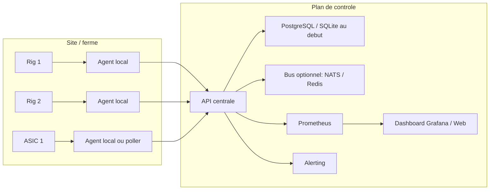

# Architecture technique concrete pour 10 a 100 rigs

## Objectif

Construire une plateforme simple, exploitable par une petite equipe, pour superviser entre 10 et 100 rigs heterogenes:

- rigs CPU/GPU avec XMRig
- ASICs avec firmware stock ou firmware optimise
- pools classiques ou P2Pool selon l'actif mine

L'idee cle est de ne pas reimplementer le miner. On se concentre sur l'orchestration, l'observabilite et le pilotage.

## Architecture cible



## Composants

### 1. Agent local sur chaque host

Responsabilites:

- lancer et surveiller le process de minage local
- interroger l'API du miner, par exemple XMRig HTTP API
- interroger un endpoint ASIC si l'appareil expose deja sa telemetrie
- appliquer des regles de watchdog
- envoyer heartbeat et metriques vers le plan de controle
- executer des actions simples: restart miner, bascule de pool, changement de profil

Technos conseillees:

- Python pour un MVP rapide
- Go si tu veux une empreinte memoire plus stable et un binaire unique

### 2. API centrale

Responsabilites:

- authentifier les agents
- recevoir heartbeats, stats et evenements
- exposer des commandes: restart, disable, set profile, maintenance mode
- stocker l'etat courant de chaque machine

Endpoints typiques:

- `POST /api/v1/heartbeat`
- `POST /api/v1/metrics`
- `POST /api/v1/events`
- `POST /api/v1/commands/{rig_id}`
- `GET /api/v1/config/{rig_id}`

### 3. Stockage

Pour 10 a 100 rigs:

- `SQLite` suffit pour un labo ou une petite ferme mono-site
- `PostgreSQL` est le meilleur palier si tu veux historique, multi-sites et dashboard fiable

Tables minimales:

- `rigs`
- `rig_profiles`
- `heartbeats`
- `metric_samples`
- `events`
- `commands`

### 4. Observabilite

Expose des mesures standardisees:

- hashrate instantane
- hashrate moyen 10 min
- accepted shares
- rejected shares
- stale shares
- temperature
- fan speed
- power draw si disponible
- uptime du miner
- nombre de redemarrages par 24h

Stack simple:

- export de metriques Prometheus
- dashboards Grafana
- alertes par mail, Slack, Telegram ou ntfy

### 5. Gestion de profils

Chaque rig doit avoir un profil declaratif:

- coin ou algo
- pools primaire et secondaires
- wallet ou worker name
- seuils thermiques
- seuil minimal de hashrate
- fenetre de stabilisation apres demarrage
- politique de restart

Exemple:

```yaml
profile: xmrig-randomx-paris-01
algo: randomx
min_hashrate: 5500
warmup_seconds: 180
restart_if_below_for_seconds: 300
restart_backoff_seconds: 120
pools:
  - url: pool-a.example:3333
    priority: 1
  - url: pool-b.example:3333
    priority: 2
thermal:
  max_cpu_temp_c: 85
```

## Topologie recommandee selon la taille

### 10 a 20 rigs

- agents locaux
- une API centrale legere
- SQLite ou PostgreSQL
- Grafana
- un seul site

### 20 a 50 rigs

- agents locaux normalises
- PostgreSQL
- Prometheus
- files d'evenements simples, par exemple Redis Streams ou NATS
- profils versionnes

### 50 a 100 rigs

- segmentation par site
- API centrale HA legere
- stockage time-series ou retention mieux geree
- gestion des maintenances et upgrades par vagues
- inventaire materiel et historique pannes

## Regles de watchdog utiles

- `process_down`: le process miner ne repond plus
- `api_unreachable`: l'API du miner ne repond plus
- `hashrate_too_low`: hashrate sous seuil apres warmup
- `high_reject_rate`: taux de shares refusees anormal
- `thermal_throttle`: temperature trop haute
- `too_many_restarts`: boucle de crash
- `pool_unreachable`: perte du pool primaire, bascule sur secondaire

## Cycle d'exploitation

1. L'agent demarre et charge son profil.
2. Il verifie si le miner tourne, sinon il le lance.
3. Il sonde les stats toutes les `n` secondes.
4. Il publie heartbeat et metriques.
5. Il applique les regles.
6. En cas d'incident, il journalise l'evenement et tente une action locale.
7. Si l'incident persiste, il escalade au plan de controle.

## Choix pratiques

### Pourquoi eviter Kubernetes au debut

Pour 10 a 100 rigs, Kubernetes ajoute souvent plus de complexite qu'il n'apporte de valeur:

- peu adapte a des machines materielles heterogenes
- plus de couches reseau et d'authentification
- plus de surface d'erreur
- demande un vrai investissement ops

Une flotte de rigs se gere souvent mieux avec:

- un agent local
- systemd ou equivalent
- une API centrale simple

### Pourquoi separer agent et control plane

- meilleure tolerance aux pannes reseau
- logique locale pour les redemarrages rapides
- centralisation des politiques et de la visualisation
- evolution progressive sans lock-in

## Roadmap d'implementation

### Phase 1 - MVP

- agent local
- support XMRig
- polling ASIC HTTP generique
- journal JSON
- config par fichier

### Phase 2 - Control plane

- API centrale
- stockage des samples
- commandes distantes
- dashboard

### Phase 3 - Optimisation

- profils versionnes
- autotuning pilote
- maintenance windows
- analyses de rentabilite par rig

## KPI utiles

- disponibilite par rig
- hashrate moyen par jour
- hash/watt
- part de temps en etat degrade
- taux de restart
- revenu estime par kWh
- MTBF par modele

## Risques a prevoir

- derive thermique
- API vendor non stable sur certains ASICs
- firmwares proprietaires limites
- watchdog trop agressif provoquant du churn
- cout reseau et stockage des metriques si retention trop longue

La bonne strategie consiste a commencer petit, fiabiliser l'agent local, puis industrialiser le plan de controle.
